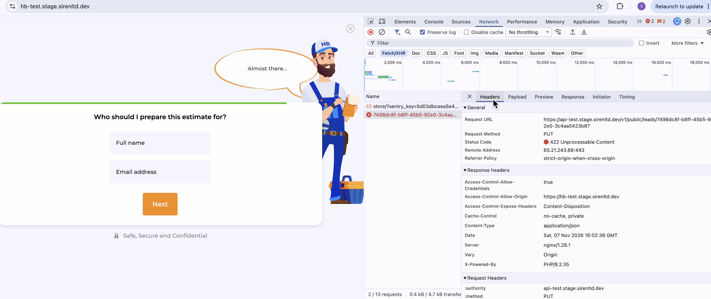

# BUG-02: "Budget" step — the API responds with 422

| Field | Value |
|---|---|
| **ID** | BUG-02 |
| **Type** | API |
| **Severity** | Medium |
| **Priority** | High |
| **Component** | Wizard, step "Do you know what your approximate budget is?" · `PUT /v1/public/leads/{uuid}` |
| **Environment** | URL: https://hb-test.stage.sirenltd.dev/ · Chrome 151.0.7922.138 · macOS 14.7.4 (23H420) |
| **Reported** | 2026-11-07 |

## Preconditions

- Chrome DevTools is open on the **Network** tab, filter `api-test`.

## Test data

- ZIP code: `10001`

## Steps to reproduce

1. Open https://hb-test.stage.sirenltd.dev/.
2. Enter ZIP `10001` in the hero form and click "Get estimate".
3. Go through the wizard steps up to the "Budget" step with any valid answers:
   - "Which elements of the kitchen would you like to update?" → "Kitchen cabinets" → "Next";
   - "What would you like to do with your kitchen cabinets?" → "Replace all or most cabinets" → "Next";
   - "What type of property is this?" → "Single family home" → "Next";
   - "Is it a mobile, modular or manufactured home?" → "No" → "Next";
   - "Are you the homeowner or authorized to make property changes?" → "Yes" → "Next";
   - "What is the approximate size of your kitchen in square feet?" → `150` → "Next".
4. On the step "Do you know what your approximate budget is?" select **"Up to \$5K"** and in the warning about the budget click "Yes".
5. Check the `PUT /v1/public/leads/{uuid}` request in Network and the wizard screen.
6. Repeat steps 1–3, then select **"\$10K to \$30K"** (no warning for this option), click "Next" and check the request again.

## Expected result

- The selected budget is accepted by the API (`2xx`) and saved in the lead.
- The wizard opens the next step.

## Actual result

- The API rejects the budget for every tested option with **422 Unprocessable Content** and `"The selected budget is invalid."`:
  - "Up to \$5K" → `budget: "1"` → 422;
  - "\$10K to \$30K" → `budget: "2"` → 422.
- The wizard opens the next step "Who should I prepare this estimate for?".
- The budget is not sent again in any later request.

## Evidence

The wizard has moved on to "Who should I prepare this estimate for?", while the `PUT` with the budget returned 422:



Request ("\$10K to \$30K"):

```http
PUT https://api-test.stage.sirenltd.dev/v1/public/leads/{uuid}
Content-Type: application/json

{
  "budget": "2",
  "trustedFormUrl": "https://cert.trustedform.com/{certificate-id}"
}
```

Response:

```http
422 Unprocessable Content

{
  "errors": {
    "budget": [
      { "code": "budget_enum", "message": "The selected budget is invalid." }
    ]
  }
}
```
