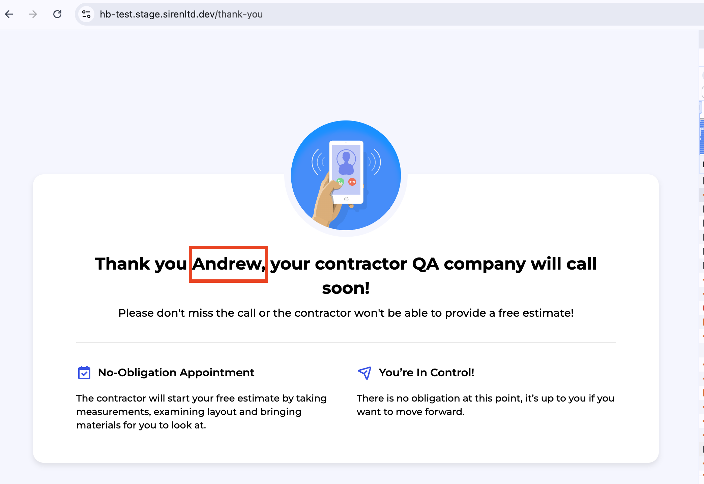

# BUG-10: Thank-you page greets the user with a wrong name ("Andrew")

| Field | Value |
|---|---|
| **ID** | BUG-10 |
| **Type** | Functional |
| **Severity** | Medium |
| **Priority** | High |
| **Component** | Thank-you page (after the lead is submitted) |
| **Environment** | URL: https://hb-test.stage.sirenltd.dev/ · Chrome 151.0.7922.138 · macOS 14.7.4 (23H420) |
| **Reported** | 2026-11-07 |

## Preconditions

- None.

## Test data

- ZIP code: `10001`
- Full name: `Yuliya Test`
- Email: `qa.test+1@example.com`
- Phone: `2125550123`

## Steps to reproduce

1. Open https://hb-test.stage.sirenltd.dev/.
2. Enter ZIP `10001` in the hero form and click "Get estimate".
3. Answer the wizard questions:
   - "Which elements of the kitchen would you like to update?" → "Lighting" + "Flooring" → "Next" → in the warning click "Yes";
   - "What would you like to do with your kitchen cabinets?" → "Replace all or most cabinets" → "Next";
   - "What type of property is this?" → "Single family home" → "Next";
   - "Is it a mobile, modular or manufactured home?" → "No" → "Next";
   - "Are you the homeowner or authorized to make property changes?" → "Yes" → "Next";
   - "What is the approximate size of your kitchen in square feet?" → `150` → "Next";
   - "Do you know what your approximate budget is?" → "\$10K to \$30K" → "Next".
4. On "Who should I prepare this estimate for?" enter Full name `Yuliya Test` and Email `qa.test+1@example.com` → "Next".
5. On "What is your phone number?" enter `2125550123` → "Submit my request".
6. In the dialog "Please confirm your phone number." click "Phone number is correct".
7. Look at the heading of the thank-you page.

## Expected result

The thank-you page greets the user by the entered name: "Thank you Yuliya…".

## Actual result

The thank-you page shows a different name:

> Thank you **Andrew**, your contractor QA company will call soon!

The lead itself has the correct name: `GET /v1/public/leads/{uuid}` returns `"fullName": "Yuliya Test"`.

Also reproduced with Full name `QA Test`: the page still shows "Thank you Andrew".

## Evidence



The lead returned by the API has the entered name:

```http
GET https://api-test.stage.sirenltd.dev/v1/public/leads/{uuid}
200 OK

{
  "fullName": "Yuliya Test",
  "zipCode": "10001",
  "phoneNumber": "2125550123",
  "leadStatus": "SUBMITTED",
  "service": { "id": 4, "name": "Kitchen Remodeling", "alias": "KR" },
  "payout": 1,
  "campaign": {
    "contractor": { "id": 1, "companyName": "QA company", "dba": null },
    "alias": "KR-lead-c702a9580f",
    "type": "lead"
  }
}
```
